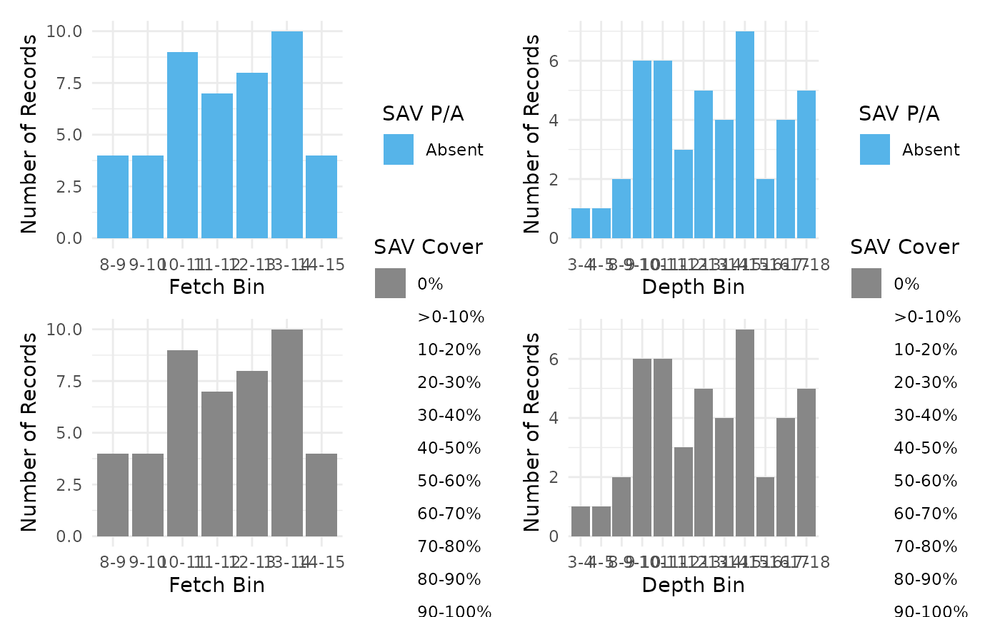
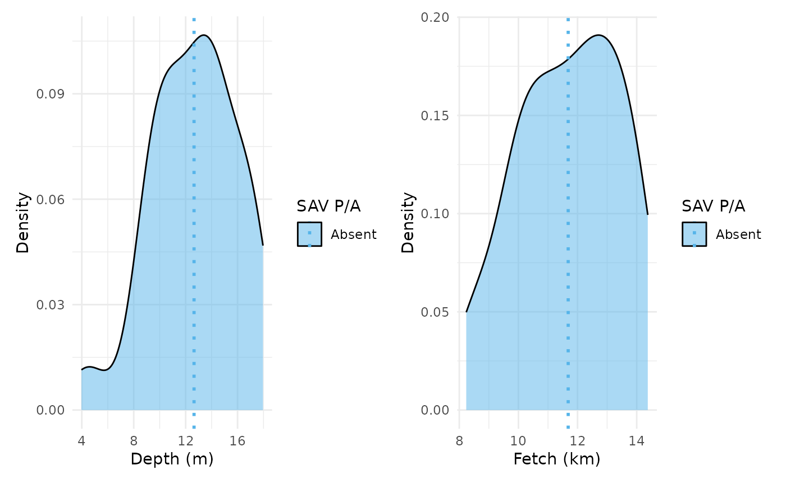
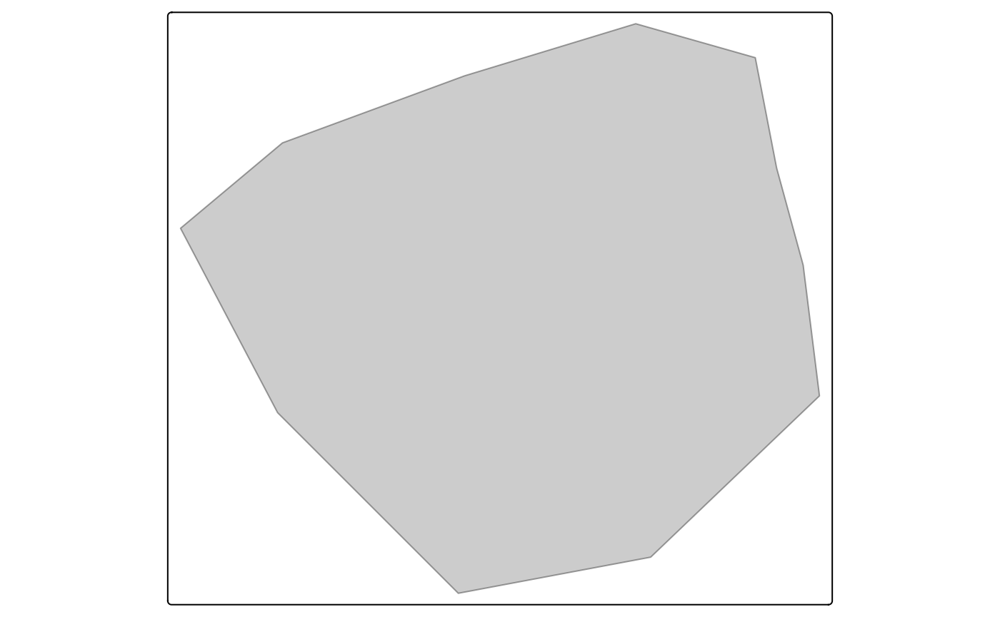

# Get started with SAVM

``` r

library(SAVM)
#> Loading required package: randomForest
#> randomForest 4.7-1.2
#> Type rfNews() to see new features/changes/bug fixes.
library(sf)
#> Linking to GEOS 3.12.1, GDAL 3.8.4, PROJ 9.4.0; sf_use_s2() is TRUE
library(stars)
#> Loading required package: abind
#> Registered S3 method overwritten by 'stars':
#>   method                  from
#>   st_interpolate_aw.stars sf
```

## Introduction

This vignette introduces the workflow provided by the **Submerged
Aquatic Vegetation Model (SAVM) R package**. The package supports
importing spatial and tabular data related to SAV presence and habitat
conditions in aquatic ecosystems. It outlines the main functionalities
of the package and walks through the typical workflow—from user inputs
to model predictions.

## User workflow

### R as a GIS

To use SAVM, basic knowledge about using R to work with spatial objects
are requried. There are several packages that turn R into a powerful
Geospatial Information System (GIS). One of the most popular is
[`sf`](https://r-spatial.github.io/sf/), which can read a wide variety
of spatial file formats, including ESRI shapefiles. Assuming you have
the following shapefile files:

    lake_erie_land
    ├── LkErie_Land_fromGLAF_Water_WGS_Feb2020.cpg
    ├── LkErie_Land_fromGLAF_Water_WGS_Feb2020.dbf
    ├── LkErie_Land_fromGLAF_Water_WGS_Feb2020.prj
    ├── LkErie_Land_fromGLAF_Water_WGS_Feb2020.sbn
    ├── LkErie_Land_fromGLAF_Water_WGS_Feb2020.sbx
    ├── LkErie_Land_fromGLAF_Water_WGS_Feb2020.shp
    ├── LkErie_Land_fromGLAF_Water_WGS_Feb2020.shp.xml
    └── LkErie_Land_fromGLAF_Water_WGS_Feb2020.shx

then
`st_read(lake_erie_land/LkErie_Land_fromGLAF_Water_WGS_Feb2020.shx)` is
used to read the shapefile into a `sf` object used to do spatial
operations with R. For instance, the shapefile can be plot as follows:

``` r

erie_land <- st_read("lake_erie_land/LkErie_Land_fromGLAF_Water_WGS_Feb2020.shx")
plot(erie_land)
```

    #> Reading layer `LkErie_Land_fromGLAF_Water_WGS_Feb2020' from data source 
    #>   `/home/runner/work/_temp/Library/SAVM/example/lake_erie_land/LkErie_Land_fromGLAF_Water_WGS_Feb2020.shx' 
    #>   using driver `ESRI Shapefile'
    #> Simple feature collection with 1 feature and 8 fields
    #> Geometry type: MULTIPOLYGON
    #> Dimension:     XYZ
    #> Bounding box:  xmin: -83.58067 ymin: 41.30372 xmax: -78.72656 ymax: 42.99789
    #> z_range:       zmin: 0 zmax: 0
    #> Geodetic CRS:  WGS 84


Note that the package `SAVM` includes a util function to invert a
polygon if you would rather use a water polygon. The fetch computation
detailed below however supports both types of polygon.

``` r

erie_lake <- erie_land |>
  invert_polygon()
#> although coordinates are longitude/latitude, st_difference assumes that they
#> are planar
#> Warning: attribute variables are assumed to be spatially constant throughout
#> all geometries

erie_lake |>
  st_geometry() |>
  plot(col = 1)
```


Using `sf` capacities, the file can then be exported in various format,
for instance in [GeoPackage](https://www.geopackage.org/):

``` r

erie_lake |> sf::st_write("lake_erie.gpkg")
```

Note that `sf` focuses on vector files, to read and manipulate raster
file we will use the package
[`stars`](https://r-spatial.github.io/stars/) that works seamlessly with
`sf`.

### Reading file

Now we consider a zone near Buffalo in the Lake Erie. Note that all the
data required are included in the package `SAVM`. We first load the
geopackage of Lake Erie.

``` r

# Lake Erie boundaries polygon (reading from SAVM internal files)
le_bound <- system.file("example", "lake_erie.gpkg", package = "SAVM") |>
  sf::st_read() |>
  sf::st_transform(crs = 3857)
#> Reading layer `lake_erie' from data source 
#>   `/home/runner/work/_temp/Library/SAVM/example/lake_erie.gpkg' 
#>   using driver `GPKG'
#> Simple feature collection with 1 feature and 1 field
#> Geometry type: MULTIPOLYGON
#> Dimension:     XYZ
#> Bounding box:  xmin: -83.47975 ymin: 41.38081 xmax: -78.85269 ymax: 42.94512
#> z_range:       zmin: 0 zmax: 0
#> Geodetic CRS:  WGS 84
```

We then load the shapefile of the area of interest that is stored as a
GeoJSON file. Note that for the area (or points) of interest, we use
[`read_sav()`](../reference/data_input.md) that returns an object of
class `sav_data`.

``` r

# Lake Erie study zone: read
study_zone <- system.file("example", "study_zone.geojson", package = "SAVM") |>
  read_sav(spacing = 2000)
#> ℹ Determining file type and processing: /home/runner/work/_temp/Library/SAVM/example/study_zone.geojson
#> ℹ spatial file detected
#> ℹ Transforming spatial data.
#> ✔ Grid of 46 points successfully generated from AOI.
```

Note that the corresponding grid can be visualized using the
[`preview_grid()`](../reference/preview_grid.md) function.

``` r

preview_grid(study_zone)
```


We now load the depth data.

``` r

# Depth (reading with stars)
study_depth <- stars::read_stars(system.file("example", "le_bathy.tiff", package = "SAVM"))
```

> ***Note on spatial projections***: *The `SAVM` package works with
> spatial coordinates in meters and the WGS 84 / UTM zone 17N
> ([epsg:32617](https://epsg.io/32617)) projection as a default option
> since it was originally developped for use in the Great Lakes (WGS 84
> / UTM zone 18N ([epsg:32618](https://epsg.io/32618)) is also a an
> option). Other viable options in a North American context are NAD83 /
> UTM zone 17N ([epsg:26917](https://epsg.io/26917)) and NAD83(CSRS) /
> UTM zone 17N ([egsg::2958](https://epsg.io/2958)).*

### Compute fetch and extract depth

#### Compute fetch

To compute wind fetch (in kilometers), we called
[`compute_fetch()`](../reference/compute_fetch.md). By default, the
maximum distance is set to 15 km (see argument `max_dist`) and the
default number of bearings is 16 (see argument `n_bearings`). Note that
if you are using a land polygon, set the argument `land_polygon` to
`TRUE`.

``` r

fetch <- compute_fetch(study_zone$points, le_bound)
#> ℹ `points` and `polygon` have different CRS, transforming
#> `points` to match `polygon` CRS.
#> ℹ Creating fetch lines
#> ℹ Cropping fetch lines
fetch
#> $mean_fetch
#> Simple feature collection with 46 features and 4 fields
#> Geometry type: POINT
#> Dimension:     XY
#> Bounding box:  xmin: -8802296 ymin: 5273114 xmax: -8780591 ymax: 5292232
#> Projected CRS: WGS 84 / Pseudo-Mercator
#> First 10 features:
#>    id_point outsider  fetch_km weighted_fetch_km                 geometry
#> 1         1    FALSE 12.006871         12.006871 POINT (-8794389 5273245)
#> 2         2    FALSE 11.297227         11.297227 POINT (-8791670 5273180)
#> 3         3    FALSE  9.807618          9.807618 POINT (-8788952 5273114)
#> 4         4    FALSE 13.778603         13.778603 POINT (-8797044 5276038)
#> 5         5    FALSE 13.111400         13.111400 POINT (-8794324 5275974)
#> 6         6    FALSE 12.380799         12.380799 POINT (-8791605 5275909)
#> 7         7    FALSE 11.437299         11.437299 POINT (-8788886 5275843)
#> 8         8    FALSE 10.087685         10.087685 POINT (-8786166 5275776)
#> 9         9    FALSE 14.375035         14.375035 POINT (-8799700 5278832)
#> 10       10    FALSE 14.236960         14.236960 POINT (-8796980 5278768)
#> 
#> $transect_lines
#> Simple feature collection with 736 features and 7 fields
#> Geometry type: LINESTRING
#> Dimension:     XYZ
#> Bounding box:  xmin: -8817296 ymin: 5262180 xmax: -8777847 ymax: 5297596
#> z_range:       zmin: 0 zmax: 0
#> Projected CRS: WGS 84 / Pseudo-Mercator
#> # A tibble: 736 × 8
#> # Groups:   id_point [46]
#>    id_point direction cardinal_direction weight OBJECTID_1
#>  *    <int>     <dbl> <chr>               <dbl>      <dbl>
#>  1        1       0   N                       1          0
#>  2        1      22.5 NNE                     1          0
#>  3        1      45   NE                      1          0
#>  4        1      67.5 ENE                     1          0
#>  5        1      90   E                       1          0
#>  6        1     112.  ESE                     1          0
#>  7        1     135   SE                      1          0
#>  8        1     158.  SSE                     1          0
#>  9        1     180   S                       1          0
#> 10        1     202.  SSW                     1          0
#> # ℹ 726 more rows
#> # ℹ 3 more variables: geometry <LINESTRING [m]>, transect_length [m],
#> #   rank <int>
```

`fetch` is a list of two elements, `mean_fetch`, an `sf` object with all
summarized computations and `transect_lines`, a `sf` object that
includes all transect lines. As `sf` objects, both elements can easily
be exported, for instance, the following code writes `fetch$mean_fetch`
as a shapefile:

``` r

fetch$mean_fetch |> sf::st_write("fetch.shp")
```

> ***Note for points outside the polygon***: points falling outside the
> polygon are identified as outsiders, see column `outsider` of
> `mean_fetch` (e.g. `fetch$mean_fetch$outsider`). To visualize them,
> use [`visualize_outsiders()`](../reference/compute_fetch.md).

#### Extract depth

To extract depth data from a raster file for our study points, we use
[`st_extract()`](https://r-spatial.github.io/stars/reference/st_extract.html)
from the package `stars`. Note that the points and the raster must use
the same projection.

``` r

depth <- st_extract(
  study_depth,
  study_zone$points |>
    sf::st_transform(crs = sf::st_crs(study_depth))
)
depth
#> Simple feature collection with 46 features and 1 field
#> Geometry type: POINT
#> Dimension:     XY
#> Bounding box:  xmin: 1369010 ymin: 2317621 xmax: 1385038 ymax: 2332455
#> Projected CRS: USA_Contiguous_Albers_Equal_Area_Conic_USGS_version
#> First 10 features:
#>    le_bathy.tiff                geometry
#> 1      13.387704 POINT (1376150 2317621)
#> 2      12.846224 POINT (1378114 2317928)
#> 3       9.828735 POINT (1380079 2318235)
#> 4      14.185731 POINT (1373874 2319302)
#> 5      14.000000 POINT (1375838 2319609)
#> 6      14.000000 POINT (1377803 2319916)
#> 7      12.106031 POINT (1379767 2320222)
#> 8       9.033901 POINT (1381732 2320529)
#> 9      17.807201 POINT (1371598 2320983)
#> 10     17.075397 POINT (1373562 2321290)
```

This returns an `sf` object whose column `le_bathy.tiff` contains the
depth values.

### Model

With the `depth` and `fetch`, we create a `sf` object that contains
predictor values for all points.

``` r

sp_dat <- fetch$mean_fetch
sp_dat$depth_m <- depth$le_bathy.tiff
```

You can generate predictions using `sav_model(sp_dat)`. By default, the
function uses the column names in the input data to identify the
relevant variables. If the column names are not recognized, you can
manually specify them using the `depth` and `fetch` parameters.

``` r

# get input
res <- sav_model(sp_dat)
#> ! No column available for post-hoc treatment.
res
#> Simple feature collection with 46 features and 7 fields
#> Geometry type: POINT
#> Dimension:     XY
#> Bounding box:  xmin: -8802296 ymin: 5273114 xmax: -8780591 ymax: 5292232
#> Projected CRS: WGS 84 / Pseudo-Mercator
#> First 10 features:
#>      depth_m  fetch_km pa_prob pa_pred cover_pred pa_post_hoc cover_post_hoc
#> 1  13.387704 12.006871       0       0          0           0              0
#> 2  12.846224 11.297227       0       0          0           0              0
#> 3   9.828735  9.807618       0       0          0           0              0
#> 4  14.185731 13.778603       0       0          0           0              0
#> 5  14.000000 13.111400       0       0          0           0              0
#> 6  14.000000 12.380799       0       0          0           0              0
#> 7  12.106031 11.437299       0       0          0           0              0
#> 8   9.033901 10.087685       0       0          0           0              0
#> 9  17.807201 14.375035       0       0          0           0              0
#> 10 17.075397 14.236960       0       0          0           0              0
#>                    geometry
#> 1  POINT (-8794389 5273245)
#> 2  POINT (-8791670 5273180)
#> 3  POINT (-8788952 5273114)
#> 4  POINT (-8797044 5276038)
#> 5  POINT (-8794324 5275974)
#> 6  POINT (-8791605 5275909)
#> 7  POINT (-8788886 5275843)
#> 8  POINT (-8786166 5275776)
#> 9  POINT (-8799700 5278832)
#> 10 POINT (-8796980 5278768)
```

Even without additional columns, the model will return columns
containing post hoc results. For SAV cover, if presence-absence
predictions are available, the `cover_post_hoc` column will contain
`cover_pred` values set to 0 where absence is predicted.

There are three additionnal limitations that can be used as posthoc
treatement. The `secchi` parameter should contain Secchi depth values
and is used to compute Vmax following the equation from Chambers and
Kalff (1985). If `depth` is also provided, it is compared to Vmax: when
the depth exceeds Vmax, both cover and presence-absence are set to 0.
The `substrate` and `limitation` parameters are binary variables that
can be used to set cover and presence-absence to 0 based on external
knowledge or site-specific constraints.

Below we used an example with random Secchi depth values:

``` r

res_secchi <- sav_model(
  cbind(sp_dat, secchi = runif(nrow(sp_dat), 4, 12))
)
#> ℹ Using secchi for post-hoc treatment.
res_secchi
#> Simple feature collection with 46 features and 10 fields
#> Geometry type: POINT
#> Dimension:     XY
#> Bounding box:  xmin: -8802296 ymin: 5273114 xmax: -8780591 ymax: 5292232
#> Projected CRS: WGS 84 / Pseudo-Mercator
#> First 10 features:
#>      depth_m  fetch_km    secchi limitation_secchi     vmax pa_prob pa_pred
#> 1  13.387704 12.006871  4.646001              TRUE 11.85349       0       0
#> 2  12.846224 11.297227 10.674664             FALSE 20.69587       0       0
#> 3   9.828735  9.807618  8.806087             FALSE 18.43276       0       0
#> 4  14.185731 13.778603  5.257668              TRUE 13.01322       0       0
#> 5  14.000000 13.111400  4.059196              TRUE 10.64919       0       0
#> 6  14.000000 12.380799  7.731148             FALSE 16.97598       0       0
#> 7  12.106031 11.437299  7.982219             FALSE 17.32805       0       0
#> 8   9.033901 10.087685  6.318138             FALSE 14.83601       0       0
#> 9  17.807201 14.375035  9.863056             FALSE 19.75001       0       0
#> 10 17.075397 14.236960 10.180172             FALSE 20.12588       0       0
#>    cover_pred pa_post_hoc cover_post_hoc                 geometry
#> 1           0           0              0 POINT (-8794389 5273245)
#> 2           0           0              0 POINT (-8791670 5273180)
#> 3           0           0              0 POINT (-8788952 5273114)
#> 4           0           0              0 POINT (-8797044 5276038)
#> 5           0           0              0 POINT (-8794324 5275974)
#> 6           0           0              0 POINT (-8791605 5275909)
#> 7           0           0              0 POINT (-8788886 5275843)
#> 8           0           0              0 POINT (-8786166 5275776)
#> 9           0           0              0 POINT (-8799700 5278832)
#> 10          0           0              0 POINT (-8796980 5278768)
```

Note that `res_secchi` is a `sf` object and can therefore be exported as
a shapefile:

``` r

res_secchi |> sf::st_write("results.shp")
```

### Vizualize

The package includes plotting helper functions.
`plot_sav_distribution(res)` allows users to visualize the distribution
of SAV cover and presence/absence across predictor bins. Alternatively,
`plot_sav_density(res)` provides a density-based visualization rather
than using binned values.

``` r

# Visualize results
plot_sav_distribution(res_secchi)
```


``` r

plot_sav_density(res_secchi)
```


Note that these functions include an option to force the use of raw
predictions without applying the post hoc treatment.

``` r

plot_sav_distribution(res_secchi, post_hoc = FALSE)
```



``` r

plot_sav_density(res_secchi, post_hoc = FALSE)
```



Finally, the function [`plot_sav_tmap()`](../reference/plot_sav.md)
allows to draw map by leveraging the package `tmap`
(<https://r-tmap.github.io/tmap/>).

``` r

study_zone$points <- cbind(study_zone$points, res)
plot_sav_tmap(study_zone)
#> The map variable `fill` of the layer "dots" and "symbols" contains a unique
#> value. Therefore a discrete scale is applied (tm_scale_discrete).
#> The map variable `fill` of the layer "dots" and "symbols" contains a unique
#> value. Therefore a categorical scale is applied (tm_scale_categorical).
```

``` r

plot_sav_tmap(study_zone, layers = "cover", interactive = FALSE)
```



## References

- Croft-White, M.V., Tang, R., Gardner Costa, J., Doka, S.E., and
  Midwood, J. D. 2022. Modelling submerged aquatic vegetation presence
  and percent cover to support the development of a freshwater fish
  habitat management tool. Can. Tech. Rep. Fish. Aquat. Sci. 3497: vi +
  30 p.

- Chambers, P.A., and Kalff, J. 1985. Depth Distribution and Biomass of
  Submerged aquatic macrophyte communities in relation to secchi depth.
  Can. J. Fish. Aquat. Sci. 42: 701–709
